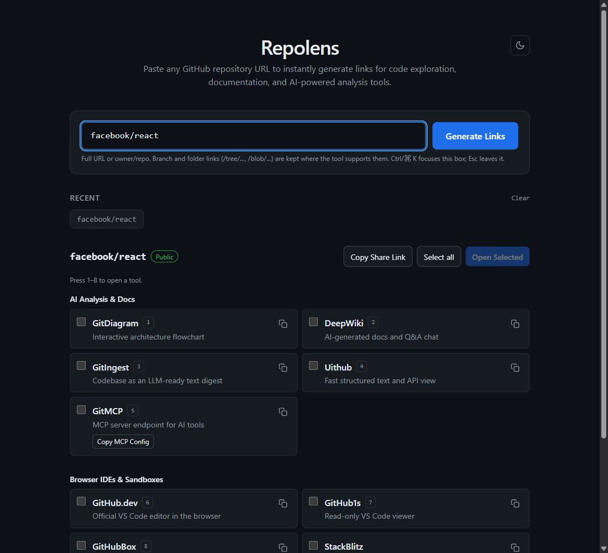

# Repolens: open any GitHub repo in AI docs, browser IDEs and code tools

Paste a GitHub repository URL and get links to 11 tools for reading, understanding and running that code. No sign-up and nothing to install.

**Live app: https://githubrepolens.vercel.app**

Try it: [facebook/react](https://githubrepolens.vercel.app/#facebook/react)



## Why

Great tools exist for exploring GitHub repositories, but each has its own URL trick (swap `github.com` for another domain, add a prefix, and so on). Repolens means you don't have to remember any of them.

## Tools

### AI analysis and docs

| Tool | What it gives you |
| --- | --- |
| GitDiagram | Interactive architecture flowchart |
| DeepWiki | AI-generated docs and Q&A chat |
| GitIngest | Codebase as an LLM-ready text digest |
| Uithub | Fast structured text and API view |
| GitMCP | MCP server endpoint for AI tools |

### Browser IDEs and sandboxes

| Tool | What it gives you |
| --- | --- |
| GitHub.dev | VS Code editor in the browser |
| GitHub1s | Read-only VS Code viewer |
| GitHubBox | CodeSandbox preview |
| StackBlitz | Runs web projects in WebContainers |
| Gitpod | Cloud dev environment |
| Sourcegraph | Code search (indexed repos only) |

These are third-party services. Repolens only builds links to them, so their availability, limits and sign-in rules are their own.

## Features

- Accepts a full URL or `owner/repo`
- Keeps the branch and folder or file path for tools whose link format includes it
- Opens several selected tools at once, and shows the links if your browser blocks pop-ups
- Shows whether a repository is public, or "private or not found"
- Copies a GitMCP config for your AI tools
- Creates a share link for any repository
- Light and dark themes that follow your system setting
- Recent repositories, saved only in your browser

## Keyboard shortcuts

| Key | Action |
| --- | --- |
| `1` to `8` | Open one of the first eight tools |
| `Ctrl` / `Cmd` + `K` | Focus the input |
| `Esc` | Leave the input |

## Run it locally

It's a single HTML file with no build step. Clone the repo and open `index.html`. It loads Tailwind from a CDN, so you need an internet connection.

```bash
git clone https://github.com/ssahilkhan/Git_ShortCut_Builder.git
```

To check URL parsing and link building (needs Node.js):

```bash
node test.mjs
```

## Known limits

- The repository status comes from GitHub's API without a token, so private and missing repositories look the same. GitHub allows 60 such requests per hour.
- Sourcegraph doesn't have a page for every repository. Its links also break for branch names that contain `/`.

## Contributing

Know a tool that should be here? [Open an issue](https://github.com/ssahilkhan/Git_ShortCut_Builder/issues) or send a pull request. Tools are defined in the `TOOLS` list in `index.html`.

If Repolens saves you time, a star helps other people find it.
